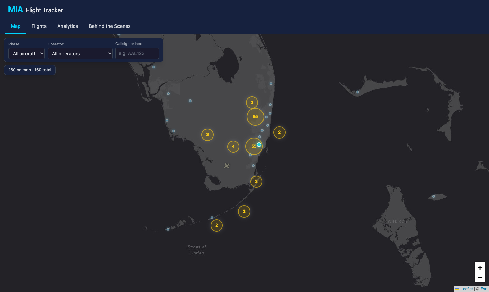
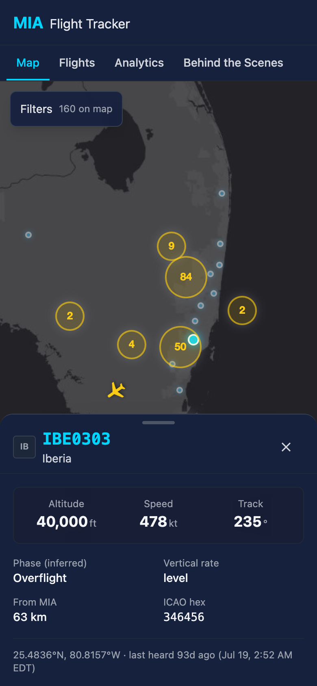
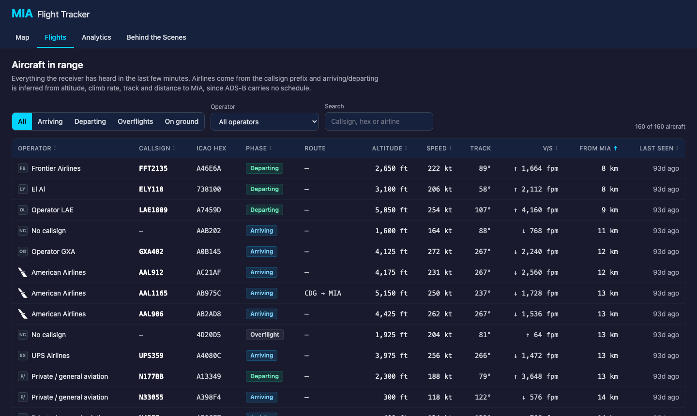
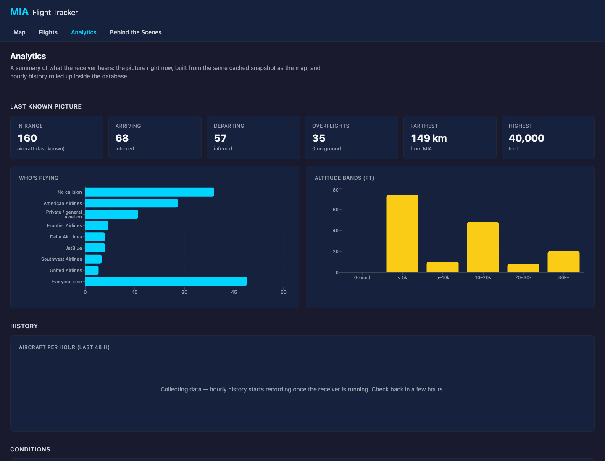
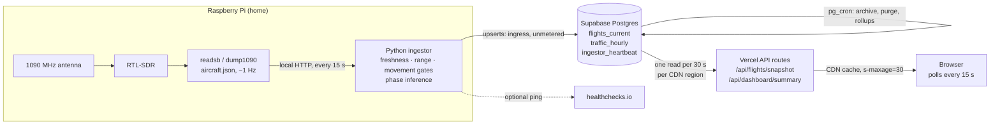

# MIA Flight Tracker

Live aircraft around Miami International, decoded from 1090 MHz ADS-B by my own Raspberry Pi
receiver (a generic RTL-SDR and an antenna facing out a window). A Python ingestor filters what the antenna hears and writes it to
Postgres (Supabase); a Next.js site on Vercel serves it through a CDN-cached API to a
Leaflet map, a sortable aircraft board and an analytics page.

**Live site:** https://track-flights-web.vercel.app ·
**How it works, in depth:** [Behind the Scenes](https://track-flights-web.vercel.app/behind-the-scenes)

| Map | Mobile, flight selected |
| --- | --- |
|  |  |
| **Flights** | **Analytics** |
|  |  |

## Architecture



## Tech stack

- **Receiver:** generic RTL-SDR dongle + 1090 MHz antenna in a window, decoder on a Raspberry Pi 3
- **Ingestor:** Python 3.11, httpx, Supabase client, structlog; systemd service on the Pi
- **Database:** Supabase Postgres with row-level security, pg_cron jobs and SQL rollups
- **Web:** Next.js 15 (App Router), React 18, TypeScript, Tailwind, Leaflet, Recharts
- **Hosting:** Vercel (serverless API routes behind its CDN)
- **Quality:** Vitest + Testing Library, pytest, ESLint/Prettier, ruff/black, gitleaks, GitHub Actions

## Design decisions and tradeoffs

**Egress, not compute, is the scarce resource.** Supabase's free tier meters data *out* (5 GB/month)
but not data in. So the Pi writes as often as it likes, and browsers never query the database:
they read `/api/flights/snapshot`, which Vercel's CDN caches for 30 s. Viewers in the same CDN
region share one database read per window. A full 250-aircraft snapshot measures about 130 KB of
JSON, 19 KB compressed, which works out to roughly 1.6 GB/month per region if someone watches
around the clock, and nothing for hours nobody is watching.

**Cache window vs. poll interval.** The browser polls every 15 s, half the 30 s cache window. New
data appears within ~15 s of a cache refresh, and the in-between polls are CDN hits that never
reach the database.

**Filter at the edge of the system.** The ingestor drops aircraft with no recent position, anything
beyond 200 km of MIA, and rewrites of aircraft that moved less than 150 m since the last write.
At a 15 s poll that last gate only skips aircraft slower than ~19 kt (parked or taxiing); every
airborne aircraft is written every poll.

**Identity.** The ICAO 24-bit hex address is an airframe's real identity; the callsign changes per
flight. Rows are keyed on the flight ident (callsign converted to IATA form, so ADS-B positions
merge with optional schedule data) with the hex as a fallback, and the site dedupes by hex.
Keying rows on the hex outright is the cleaner design; see [Known limitations](#known-limitations).

**Inferring arrivals and departures.** ADS-B has no flight plan. Phase comes from altitude,
vertical rate, track and distance to KMIA: descending below 12,000 ft within 60 km is an arrival,
climbing and not pointed at the airport is a departure, cruise traffic and holding are
overflights. The same rules run in the ingestor (Python) and the site (TypeScript), with shared
test cases. A trained classifier can replace them (next section).

**Models, and only if they beat a baseline.** Three models run on what the receiver hears (code
in `apps/ml`, details in its README):

- *Busy/quiet alerts:* each hour against the same hour of the week over 8 weeks, using median
  and MAD inside Postgres, ignoring hours when the receiver was partly down.
- *Traffic forecast:* next 6 hours from calendar, weather forecast and the same hour last week;
  ridge vs gradient boosting, against "same hour last week" and the hour-of-week average.
- *Learned arrival/departure:* the Pi logs every aircraft's positions locally (no egress); each
  position is labeled by what that aircraft did next (landed at MIA, took off from it, used
  FLL/OPF/..., or never came low), and a classifier trained on those labels competes with the
  hand-written rules.

Each is scored on days it never saw and exported only if it wins. Models ship to the Pi as small
JSON files evaluated without scikit-learn; tests check that evaluator matches scikit-learn to
1e-9. Results, including models that lost, show on the Behind the Scenes page.

**Be honest about staleness.** "Live" is derived from the age of the newest data and an ingestor
heartbeat, not from whether the API answered. When the receiver is down the site says so, shows
when data last arrived, and greys out the last known positions. A fresh heartbeat with zero
aircraft is reported as "no signal", which points at the antenna or SDR rather than the software.

**Least privilege.** The browser only ever has the anon key (read-only by RLS). The service-role key
lives in a `chmod 600` env file on the Pi. Write-capable SQL functions are executable only by
`service_role`.

## Run it locally

Prerequisites: Node 18+ (22 recommended), Python 3.11+, a Supabase project.

```bash
git clone https://github.com/mendyraul/TrackFlights.git
cd TrackFlights
npm install
```

**Database.** Apply `supabase/migrations/*.sql` in filename order (Supabase SQL editor, or
`npx supabase db push` with the CLI linked to your project), then optionally `supabase/seed.sql`.

**Web app.** Create `apps/web/.env.local`:

```bash
NEXT_PUBLIC_SUPABASE_URL=https://<project-ref>.supabase.co
NEXT_PUBLIC_SUPABASE_ANON_KEY=<anon-key>
```

```bash
npm run dev            # http://localhost:3000
npm run build          # production build
```

**Ingestor** (on the Pi, or any machine that can reach the decoder's `aircraft.json`):

```bash
cd apps/ingestor
python3 -m venv venv && source venv/bin/activate
pip install -r requirements.txt
cp ../../infra/systemd/env.adsb.example ../../.env.adsb   # then set SUPABASE_* and ADSB_JSON_URL
python -m src.main
```

For a permanent install use `infra/systemd/mia-ingestor-adsb.service`; see
[docs/hardware-adsb-ingest.md](docs/hardware-adsb-ingest.md).

**Checks** (what CI runs):

```bash
npm run lint && npm run type-check
npm test --workspace=apps/web
cd apps/ingestor && pip install -r requirements-dev.txt && \
  SUPABASE_URL=https://example.supabase.co SUPABASE_SERVICE_ROLE_KEY=placeholder pytest -q
cd apps/ml && pip install -r requirements.txt && python -m pytest tests -q   # model export parity + training
./scripts/test-sql.sh   # all migrations + SQL tests on a throwaway Postgres (needs Docker)
```

## Repository layout

```
apps/web/          Next.js site and API routes (CDN-cached snapshot + dashboard summary)
apps/ingestor/     Python ingestor: ADS-B provider, gates, phase inference, heartbeat, rollups,
                   local track log, and the JSON model evaluator / forecast + phase services
apps/ml/           Training and evaluation (laptop only): labeling, baselines, export to JSON
supabase/          SQL migrations (schema, RLS, pg_cron jobs, rollups, anomaly detection),
                   seed, and tests/ run by scripts/test-sql.sh
infra/systemd/     Unit files and env examples for the Pi
infra/compose/     Docker Compose for running the web app and ingestors in containers
docs/              Architecture, operations runbooks, cost guardrails, ADRs
```

## How I built it

The receiver and the design calls are mine: using my own antenna instead of a paid flight API,
caching at the CDN to stay inside Supabase's free egress, and inferring arrivals and departures
from ADS-B alone. I wrote a lot of the code with Claude Code as a pair programmer, and the commit
history shows it. I review what it writes, and I can walk through any part of this repo.

## Known limitations

- Rows are keyed by flight ident rather than ICAO hex, so one aircraft can briefly own two rows
  (the site dedupes by hex). Moving the key to the hex needs a migration and a change to how
  ADS-B and schedule rows merge.
- Until the classifier has enough track history to train (and beats the rules), phase is a
  heuristic: an arrival into Fort Lauderdale looks like an arrival into MIA. Labels depend on
  seeing aircraft low near a field, which an indoor antenna does less often.
- Hourly history starts when the traffic-history migration is applied and the receiver runs;
  there is no backfill, so the forecast and alerts need weeks of data before they switch on.
- A single receiver is a single point of failure; [ADR 0002](docs/adr/0002-single-pi-ingestor-risk-matrix.md)
  covers the risks and the failover plan.

## More documentation

- [Architecture](docs/architecture.md) · [Cost guardrails](docs/cost-guardrails.md) ·
  [Deployment](docs/deployment.md) · [Docs index](docs/README.md)
- Operations: [runbook](docs/runbook.md)
